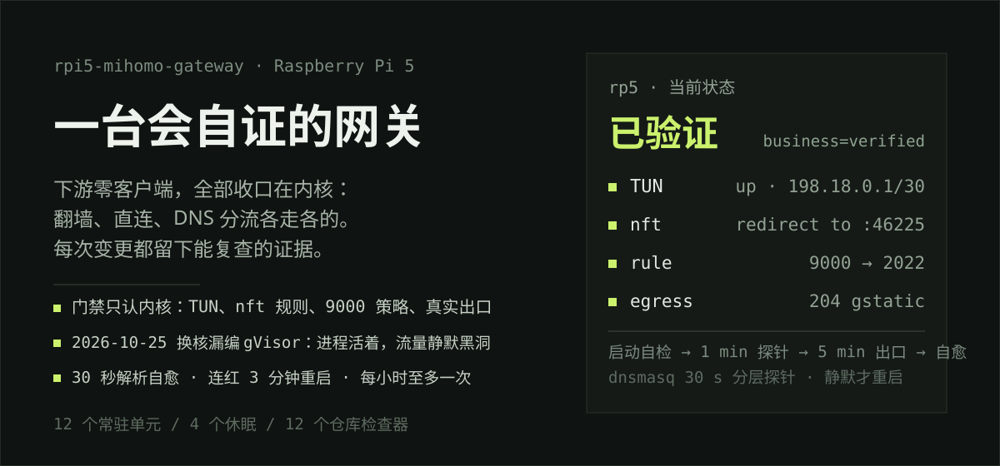
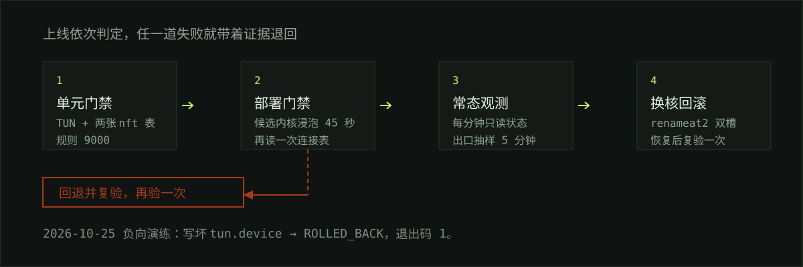
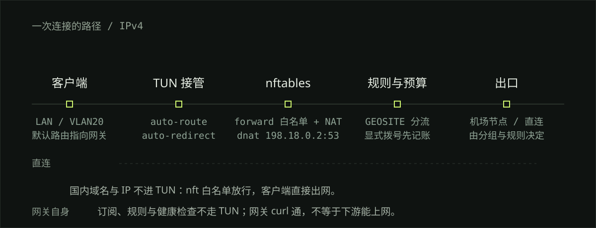

一台 Raspberry Pi 5 透明网关的**可复现镜像**：上游路由器 → rp5 → VLAN20 试点 Wi-Fi / WireGuard 对端。
下游设备不装客户端；国内直连、海外与指定业务走 TUN，DNS 三层分流，显式节点检测先过本地预算准入。

> 仓库描述**这一台机器**（Debian 13 / arm64）的现状。换机器要改网段、接口名、VLAN 与订阅数据；
> 它不是开箱即用的一键安装器。

<p align="center">
<a href="#30-秒看懂">30 秒看懂</a> ·
<a href="#安全网失败时谁兜底">安全网</a> ·
<a href="#一次连接怎么走">数据面</a> ·
<a href="#单元14-个-enabled3-个休眠">单元表</a> ·
<a href="#装成这台机器">安装</a> ·
<a href="#边界">边界</a> ·
<a href="docs/README.md">文档索引</a>
</p>

## 30 秒看懂

| 你关心的事 | 这台机器的做法 |
|---|---|
| 四个网段 | 一根网线接 UCG 交换机：`wan0` 192.168.0.117/24（VLAN1，上游 + 管理入口）与 `proxy20` 192.168.20.1/24（同一根线上的 802.1Q VLAN 20，服务 UCG 广播的 `RP5-PC-TEST` Wi-Fi 客户端）→ `wg-ucg-pilot` 10.253.254.1/30（UCG 点对点）→ Mihomo TUN 198.18.0.1/30 |
| 三层 DNS | `dnsmasq` 两个作用域：VLAN20 `192.168.20.1:53` 直投 Mihomo DNS `127.0.0.1:1053`（fake-IP）；环回 `127.0.0.1:53`（网关自身）→ `mosdns` 127.0.0.1:5335（国内/海外分流）→ Mihomo DNS |
| 自编译预算版核心 | `/usr/local/bin/mihomo` = `v1.19.28-budget-status-contract-v3`，`go1.27.2`，tags `no_tailscale, with_gvisor`；补丁与构建说明在 [`core/`](core/README.md) |
| 预算外壳 | `mihomo-measurement-budget.service` 建 `/run/mihomo-measurements/budget.sock`；drop-in 用 `--run-core` 校验协议与状态后拉起核心，账本首次预扣时创建，协议 `mihomo-budget-v1` |
| 门禁 | 启动后验 TUN、两张 nft 表、`redirect to` 规则、9000 规则并取一次 204；之后持续观测，连续红就自愈；状态写 `/run/mihomo-healthcheck/status` |

## 安全网：失败时谁兜底



断言的对象是内核与链路，不是进程存活。四层时间尺度叠在一起，任何一种静默失败都会在可接受的时间内被抓住：

| 层 | 判定对象 | 周期 | 失败动作 |
|---|---|---|---|
| 启动门禁 | TUN 存在、`inet mihomo` 表内有 `redirect to :` 规则、`9000` 策略路由、一次真实 204 | 每次启动 | 不通过就不算上线，`ExecStartPost` 返回失败 |
| 常态探针 | 上述四项 + 转发计数 | 每 1 分钟 | 连续 3 分钟红 → 重启核心（每小时至多一次） |
| 出口抽样 | `curl --socks5-hostname` 走 mixed-port 取 204 | 每 5 分钟 | 计入门禁，触发同上 |
| 解析自愈 | 本机 `:53` 两种域名解析；失败时升级到 `:5335` 与公共 DoH 对比 | 每 30 秒 | 判定 dnsmasq 静默才重启；冷却 + 15 分钟预算，单次事故只推一条 |
| 节点探测 | 组内每个节点穿节点取一次状态码（`204` / `200-499` / `401`），结果决定组内排序 | 每 250 秒 | `url-test` 自动换最快可用，`fallback` 顺序降级 |
| 告警 | 单元失败、门禁迁移、解析重启、MosDNS 兜底、巡检五类 | 事件驱动 | `mihomo-alert` 推送（Server酱 / Bark），同 key 去重 |

## 一次连接怎么走



`ip rule 9000` 把 `proxy20`/`wg-ucg-pilot` 的流量送进表 `2022`，`inet mihomo` 在 prerouting
先做白名单（核心自身、非内网、私网段直接 return），再把 DNS 查询 `dnat` 到 `198.18.0.2:53`、
TCP 重定向到 `:46225`、UDP 交给 TUN。过滤由 `inet rp_filter`（input/forward 默认 drop）与
`ip rp_nat`（自身不放 LAN masquerade，VLAN20 与 WireGuard 的 NAT 在 include 文件里）完成。整张网段图见
[`assets/network-topology.svg`](assets/network-topology.svg)，结构说明见[架构文档](docs/architecture.zh-CN.md)。

## 单元：14 个 enabled、3 个休眠

| 单元 | 作用 | 周期 |
|---|---|---|
| `mihomo.service` | 代理核心，`ExecStart` 被 drop-in 覆盖为预算 broker 的 `--run-core` | 常驻 |
| `mihomo-measurement-budget.service` | 预算准入 broker：建 socket；账本在首次预扣时创建 | 常驻 |
| `mihomo-healthcheck.timer` | 四要素探针 + 计数器，失败时按锁恢复进程 | 每 1 分钟（抖动 3s） |
| `mihomo-dnsmasq-guard.timer` | 分层解析探针：`127.0.0.1:53` 无答案先查 `127.0.0.1:5335`，迟滞判定后才重启；重启有冷却与预算 | 每 30 秒 |
| `mihomo-subscription-update.timer` | 校验候选、备份及业务检查后刷新自动来源；失败恢复 | 开机 10 分钟，任务结束后每 48 小时 |
| `mihomo-media-guard.timer` | 对 Social / Streaming 做有界媒体采样；仅合格节点进入原生 fallback，默认策略关闭 | 每分钟唤醒，采样间隔由策略控制 |
| `mihomo-watch.timer` | 单元/温度/磁盘/内存/WAN 巡检 | 开机 90s 后每 2 分钟 |
| `mosdns.service` | 分流解析；起停时切换 dnsmasq 上游模式 | 常驻 |
| `mosdns-healthcheck.timer` | 校验 5335 分流与 metrics | 开机 30s 后每 1 分钟 |
| `mosdns-rules-update.timer` | 原子更新 MosDNS 规则数据 | 每天 04:20（抖动 30 分钟） |
| `mosdns-binary-update.timer` | 官方稳定版 MosDNS 换核 | 每周日 05:10（抖动 1 小时） |
| `dnsmasq.service` | 环回 resolver（`/etc/dnsmasq.d/resolver.conf`，`127.0.0.1:53`）；启动前写入直连上游基线；崩溃自动重启 | 常驻 |
| `dnsmasq-vlan-pilot.service` | `proxy20` 试点 DHCP + DNS（租约 12 小时） | 常驻 |
| `homeassistant-access-guard.service` | 从 `wan0`/`wlan0` REJECT `tcp/8123`，上游侧访问不到 Home Assistant UI | 开机一次 |

本机另有 1 个非发布层单元处于 enabled：`rp5-agent.service`（`0.0.0.0:8799` 只读状态，供
T-Display-S3 监视器），属于这台机器的本地附加物（2026-10-26 已移除对已退休 iKuai 的
`ikuai-wan-watch.service`）。

其余 worker（`mihomo-healthcheck.service`、`mihomo-watch.service`、`mihomo-alert@.service`、
`mihomo-download-quality.service` 等）是 `static`：没有 `[Install]`，由 timer 或 `OnFailure` 拉起。

**3 个休眠**（随仓库安装、保持关闭；2026-10-25 已清掉本机 2 个退役评分单元，真机与仓库一致）

| 单元 | 原因 |
|---|---|
| `mihomo-download-quality.timer` | 质量采样会写 `./providers/quality-*.yaml`，但配置没声明对应 file provider，产物无人读取 |
| `mihomo-social-quality.timer` | 同上，仅 X 视频场景 |
| `mihomo-rules-update.timer` | 规则更新由核心 `rule-providers`（file 型）与 MosDNS 更新承担 |

休眠不等于卸载：文件仍在 `/etc/systemd/system/`，`systemctl start` 可手动跑一次。

## 2026-10-25 事故：为什么门禁只认内核状态

换核时漏编 `with_gvisor`，`mihomo -t` 通过、进程常驻，但 TUN 从未建立：国内直连照常，
所有代理流量静默黑洞。当时的探针只看 nft 表是否存在，唯一的出口抽样走 mixed-port，
绕开 TUN/redirect 链路，所以 TUN 没起来时照样返回 204、门禁照样绿。
现在的启动门禁读表内真实规则、并要求一次走代理链路的出口验证。

## 装成这台机器

仓库只发布“装成这台机器”的运行层，不含网络事务、订阅内容与凭据。从裸 Debian 13 起：

```sh
# 1. 网络身份（手工一次性）：wan0 DHCP（VLAN1）、proxy20 = 同一根线上的 802.1Q VLAN 20、
#    wg-quick@wg-ucg-pilot，及 /etc/sysctl.d/99-router.conf
sudo ip -br addr                      # wan0 / proxy20 / wg-ucg-pilot 都要有地址（TUN 由核心创建）
# 2. 数据面：/etc/nftables.conf → inet rp_filter + ip rp_nat（结构见架构文档）
sudo nft -c -f /etc/nftables.conf
# 3. 运行层：脚本、单元、env 示例、dnsmasq/mosdns/mihomo 配置骨架
sudo automation/install.sh --dry-run
sudo automation/install.sh            # 机制文件覆盖、配置保已有；只 enable 发布层 14 个单元
# 4. 核心与配置：/usr/local/bin/mihomo 用 core/ 构建并校验版本串
sudo /usr/local/sbin/mihomo-healthcheck --startup-check 30
sudo cat /run/mihomo-healthcheck/status
```

日常操作见[运维文档](docs/operations.zh-CN.md)，装机与故障处理见[部署文档](docs/deployment.zh-CN.md)。

## 仓库与真机的一致范围

2026-10-25 对真机做了一次逐文件 `sha256sum` 对照：

| 范围 | 文件 | 状态 |
| --- | --- | --- |
| 机制实现 | `automation/sbin/*`（22 个脚本） | 与 `/usr/local/sbin/` **逐字节一致** |
| 单元与 drop-in | `automation/systemd/**`（32 个文件） | 与 `/etc/systemd/system/` **逐字节一致** |
| 数据与解析 | `automation/etc/mosdns/**`、`automation/etc/dnsmasq-upstreams.*`、`automation/policy/route-defaults.yaml`、NetworkManager dispatcher | **逐字节一致** |
| 脱敏模板 | `automation/etc/dnsmasq/{resolver.conf,vlan-pilot.conf}` | 仓库用 RFC 5737 / RFC 7042 占位，真机是真实地址，**按设计不同** |
| 站点态 | `automation/policy/capabilities.yaml`、`automation/etc/mihomo/config.local.yaml` | 账号、开关与私有覆写只在真机 `/etc/mihomo/adaptive/` 与合并后的 `config.yaml` 里 |
| 凭据 | `secrets/*`、`/etc/mihomo-alert.env`、`/etc/mihomo/reconcile-targets.conf` | 不发布、不入库 |

## 被删除的旧结构

这个仓库曾同时维护“一键安装器 + 手动渲染器 + 运维层”三条产品线，与这台机器的现状不符，已删除：

- `setup.sh`、`gateway/`：旧的一键安装器与默认值；网络事务由部署端手工完成。
- `web/`、`design-demos/`、根目录 `dir-*-hero.svg`：旧发布页与设计演示。
- 旧的影子评分与自动应用脚本，以及 4 个 unit：已被原生 URL 检测 + 预算准入取代。
- `assets/current-*.{mmd,svg}`：旧网段与旧 DNS 流程的 8 个过期生成物。

保留 `assets/historical-automation-2026-10-11.*` 作为历史快照；旧调试档案在
[docs/deployment-debugging-summary.zh-CN.md](docs/deployment-debugging-summary.zh-CN.md)，外部项目研究在 [docs/research/](docs/research/)。

## 边界

| 有证据 | 不能由此推断 |
|---|---|
| 2026-10-25 对真机 rp5 的只读取证（`ssh rp5`，86 个文件快照）、服务状态、端口、单元表 | 所有硬件组合、断电恢复与长期稳定性都已验收 |
| 启动门禁 + 30 秒解析自愈 + 每分钟探针 + 5 分钟出口抽样 + 连红 3 分钟自愈重启 | 检测周期不等于瞬时可用；重启只治黑障，救不了节点或上游故障；连接切换会迁移已有 TCP/WebSocket 会话 |
| 预算服务校验协议、账本与预扣 | 平台解锁、账号可用、节点吞吐或供应商允许下载 |
| `nft -c -f` 通过 | 目标机之外的环境可用；本机 nftables 表是部署端文件，不是通用模板 |

入站模型：`lo` 与 established 之外，`wan0`/`wlan0` 只收上游 LAN 的 SSH 与 `8799`，
VLAN20 的管理口由 `nftables.d/vlan-pilot.nft` 单独放行；透明代理靠 `ip rule 9000` 与
`redirect` 工作，不再依赖整口信任。公开暴露面只有 `192.168.0.0/24` 可达的 SSH 与 `8799`，
详见 [SECURITY.md](SECURITY.md)。
本仓库不发布订阅地址、节点标签、controller secret、WireGuard 私钥与真实 MAC。

## 发布前自查

```sh
python3 tools/validate_public.py
python3 tools/check_automation.py        # 脚本/单元/env 示例与安装器的一致性
python3 tools/check_dnsmasq_guard.py     # 解析自愈的分层判定、预算与告警去重
python3 tools/check_mihomo_policy.py     # 生成的每个组都带健康探测，间隔不超上限
python3 tools/check_publication_privacy.py
```

一次跑完全部检查用 `scripts/preflight.sh`（`--staged` 为 2 秒快档，全量实测约 35 分钟）；
既有失败登记在 `scripts/preflight-baseline.txt`，负载敏感项登记在 `scripts/preflight-advisory.txt`。

生产配置改动只走设备上的 `/usr/local/sbin/mihomo-config-install`（源：`ops/mihomo-config-install`）：
先 `mihomo -t` 校验候选，打印 diff 与可改写该文件的进程和 timer，备份后才写入并 reload，失败自动回滚。

[CC0 1.0 Universal](LICENSE) · 第三方产品名与商标归各自权利人所有。
