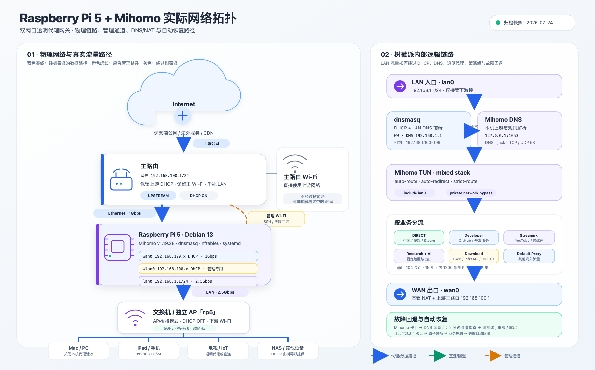

# Raspberry Pi 5 + Mihomo Gateway Guide

一套经过实际部署和故障验证的 Raspberry Pi 5 + Mihomo 双网口透明代理网关记录。

本仓库侧重：

- Raspberry Pi 5 双网口网络规划
- Mihomo TUN、DNS、DHCP、NAT 和策略分流
- 多订阅融合与自动节点切换
- GitHub、YouTube、AI 和大文件下载专项策略
- DNS fail-open、健康检查、自动恢复和配置回滚
- AP 下载慢、客户端代理掩盖故障等真实问题的诊断方法

> This repository is a sanitized documentation archive. It does not contain
> subscription URLs, node credentials, Wi-Fi passwords, dashboard secrets, or
> private backup archives.



## Repository contents

| Path | Description |
|---|---|
| [`docs/deployment-debugging-summary.zh-CN.md`](docs/deployment-debugging-summary.zh-CN.md) | 完整中文部署、调试、优化和故障总结 |
| [`assets/network-topology.svg`](assets/network-topology.svg) | 可编辑矢量网络拓扑图 |
| [`assets/network-topology.png`](assets/network-topology.png) | 1800×1120 PNG 预览图 |
| [`web/index.html`](web/index.html) | 响应式拓扑浏览页面 |
| [`LICENSE`](LICENSE) | CC0-1.0 公共领域奉献协议 |

## Topology

```text
Internet
  ↓
Main router · 192.168.100.1/24
  ├── Main Wi-Fi: bypasses Raspberry Pi
  ├── wlan0: emergency management path
  └── Ethernet 1 Gbps
       ↓
     wan0
Raspberry Pi 5 · Debian 13
  ├── dnsmasq
  ├── nftables
  ├── Mihomo TUN
  └── systemd health checks and rollback
       ↓
     lan0 · 192.168.1.1/24 · 2.5 Gbps
       ↓
Switch / access point
       ↓
LAN clients
```

## Important boundaries

- WAN 和 LAN 必须使用不同子网。
- 主路由 DHCP 可以保留；下游 AP 必须使用桥接/AP 模式并关闭自己的 DHCP。
- 网关无法看到 Windows 客户端进程，因此进程级分流应在终端本机完成。
- `Download` 策略只能覆盖已匹配到下载规则的域名，不能按传输字节数自动识别未知大文件。
- 在生产环境修改 NetworkManager、nftables 或 DNS 前，必须保留 Wi-Fi、串口或本地终端回退通道。

## Validation

仓库通过 GitHub Actions 检查：

- 必需文档和图像是否存在
- SVG 是否为有效 XML
- HTML 是否引用仓库内的 SVG
- 是否意外包含本机绝对路径
- 是否出现已知订阅令牌或密码模式

## License

本仓库使用 [CC0 1.0 Universal](LICENSE)。在法律允许的最大范围内，你可以复制、修改、分发和用于商业用途，无需请求许可。

第三方产品名和商标仍归其各自权利人所有。
