# Raspberry Pi 5 + Mihomo 双网口透明代理网关（公开模板）

在可信的本地内网里，把一台双网口 Raspberry Pi 5 放在上游路由器与下游交换机 / AP 之间：Mihomo 用 rule 模式和
TUN / auto-redirect 做透明转发，dnsmasq 负责内网 DHCP 与 DNS，nftables 负责转发与 NAT，客户端不需要逐台配置代理。
本仓库是脱敏后的公开版本，提供参数模板、只生成文件的配置生成器、当前架构与运维文档和自适应选节点的设计说明；
不包含生产订阅、完整规则库、节点凭据、管理密钥或自适应执行器源码，也不是一键还原镜像。

文档更新：2026-10-11。当前方案与历史部署记录分开维护。

> 当前架构以 [当前架构文档](docs/current-architecture.zh-CN.md) 为准；
> [旧长文](docs/deployment-debugging-summary.zh-CN.md)、`network-topology.*` 旧拓扑图片和
> [拓扑浏览页面](web/index.html) 是历史档案，不代表当前网段、链路速率或策略。

## 适用场景

| 项目 | 说明 |
|---|---|
| 目标环境 | 单点、可信的本地内网（家庭 / 小工作室）；不适用于公网远程管理、多租户隔离 |
| 网关位置 | 上游路由器（DHCP / NAT）与下游交换机 / 桥接 AP 之间，下游为 IPv4 only |
| 分流方式 | Mihomo rule 模式 + TUN / auto-redirect 透明转发 |
| 管理方式 | 管理终端连接上游 Wi-Fi，经上游 LAN 访问 Pi 的 wan0 地址（SSH） |
| iKuai | 无依赖：旧方案里的 iKuai 设备已经移除，上游路由器与下游 AP 都不需要运行代理 |

Pi 不需要连接管理 Wi-Fi，也不需要 wlan0：只要管理终端能经上游内网访问 wan0 的地址即可。WAN / LAN 接口在部署端
按永久 MAC 固定命名，仓库不发布真实 MAC、SSID 或 NetworkManager 连接文件。

## 当前拓扑（示例地址均为虚构值）

[](assets/current-topology.svg)

实线表示物理连接，虚线表示 SSH 管理路径。管理终端接上游 Wi-Fi，不要求树莓派启用 wlan0。

`10.66.0.0/24` 与 `10.77.0.0/24` 只是示例，实际值由部署者在模板里提供；生成器要求两侧都是 RFC1918 私有网段、
互不重叠，并要求下游有可用主机地址。

### DNS 数据流：生产分层与模板基线

[](assets/current-dns-flow.svg)

实线为生产 DNS 路径；虚线为公开生成器的简化路径。MosDNS 并非替代 DHCP 服务，dnsmasq 始终承担下游 DHCP。

## 组件

| 组件 | 作用 | 公开状态 |
|---|---|---|
| dnsmasq / MosDNS | 下游 DHCP 与 DNS :53；MosDNS 在生产做国内 / 代理 / 自定义域名分层与 CN IP 校验 | dnsmasq 由生成器提供；MosDNS 规则与配置需自行准备 |
| Mihomo | 规则分流、TUN / auto-redirect 透明转发、fake-IP DNS、mixed-port 显式代理 | 生成器提供配置与 provider 骨架 |
| nftables | 转发与 NAT，只管理自己声明的表 | 生成器提供 |
| systemd | 服务自启动与定时更新任务；生成器不写单元、不安装 | 单元由部署者按发行版准备 |

## 公开范围与生产实现的区别

| 能力 | 本仓库公开内容 | 生产环境实际使用 |
|---|---|---|
| 参数模板与配置生成 | [参数模板](examples/site.example.json) + [生成器](tools/render.py)，只生成 8 个私有文件 | 独立维护的生产配置与私有站点参数，不由公开模板完整还原 |
| 防火墙基线 | 生成 nftables 表 `rp_filter` / `rp_nat`，只替换自己的两张表 | 相同基线，另加业务相关的表 |
| DNS 分层 | 生成 dnsmasq → Mihomo DNS 基线；MosDNS 分层只有设计说明 | MosDNS 国内 / 代理 / 自定义域名集合 + CN IP 集合 |
| 订阅获取与合并 | 不包含；provider 文件由部署者自行转换 | 私有订阅合并器、更新任务、节点数据库与管理密钥（需独立备份） |
| 规则库 | 仅少量示例域名规则 | 国内、游戏、流媒体、AI 与下载分类规则，仍需持续维护覆盖范围 |
| 评分与隔离执行 | 仅设计说明；生成配置只含 Mihomo 自带的 provider 健康检查 | 分类指标采集 + EWMA 评分、影子观察与受门禁保护的应用 |
| 一键安装 | 不提供，也不写入 systemd 单元 | 人工分阶段部署与验收 |

## 快速开始

生成器只需要 Python 3 标准库；生成阶段不需要 root，也不会接触正在运行的网关。实际部署还需目标系统上的
nftables、dnsmasq、Mihomo 等组件，版本与准备事项见 [分阶段部署](docs/deployment-current.zh-CN.md)。

```sh
git clone https://github.com/ashllll/rpi5-mihomo-gateway-guide.git
cd rpi5-mihomo-gateway-guide
cp examples/site.example.json site.local.json
# 编辑 site.local.json：接口名、网段、LAN 地址、DHCP 范围和端口要与本机实际环境一致。
python3 tools/render.py --site site.local.json --output rendered

# 仓库自带检查（在检出目录运行）：
python3 tools/validate_public.py
python3 tools/check_render.py

# 在目标系统上检查候选配置（只检查，不安装、不重启服务）：
sudo nft -c -f rendered/nftables.conf
sudo dnsmasq --test --conf-file=rendered/dnsmasq-lan.conf
mihomo -t -d rendered/mihomo
```

`tools/render.py` 只有 `--site` 和 `--output` 两个参数；输出目录必须尚不存在，脚本拒绝覆盖已有目录。生成目录权限
`0700`、8 个文件权限 `0600`，controller secret 每次随机生成。

### 站点参数

| 字段 | 示例值 | 说明 |
|---|---|---|
| `wan_interface` / `lan_interface` | `wan0` / `lan0` | 上游 / 下游接口名，部署端按永久 MAC 固定 |
| `management_cidr` | `10.66.0.0/24` | 允许 SSH 管理 Pi 的上游内网网段，同时作为直连规则 |
| `lan_cidr` | `10.77.0.0/24` | 下游网段，必须与上游不重叠 |
| `lan_address` | `10.77.0.1` | 网关地址，同时是 DHCP 网关和 DNS |
| `dhcp_start` / `dhcp_end` | `10.77.0.100` / `10.77.0.199` | DHCP 地址池，必须排除网关地址 |
| `dhcp_lease` | `12h` | DHCP 租约时长 |
| `mixed_port` / `controller_port` | `7890` / `9090` | 混合端口与 Mihomo 控制端口（secret 每次随机） |
| `mihomo_dns_port` / `mosdns_port` | `1053` / `5335` | Mihomo DNS 端口；MosDNS 预留端口，当前不生成其配置 |
| `dns_upstreams` | `223.5.5.5`、`1.12.12.12` | Mihomo DNS 的引导 / 默认上游 |

生成器会校验接口名合法且 WAN ≠ LAN、两侧都是 RFC1918 且不重叠、LAN 前缀不超过 `/30`、网关与 DHCP 端点可用、
DHCP 范围有序且不含网关、4 个端口是 `1024-65535` 内互不相同的整数、租约格式合法、至少一个 DNS 上游。它只写文件：
不联网、不安装、不重启服务，也不修改 sshd、NetworkManager、路由或 IPv6 配置。

### 生成的 8 个文件

| 文件 | 内容 |
|---|---|
| `nftables.conf` | 输入 / 转发 / NAT 规则与地址伪装 |
| `dnsmasq-lan.conf` | 下游 DHCP 与 DNS 转发 |
| `gateway-sysctl.conf` | IPv4 转发与 rp_filter / redirect 相关开关 |
| `mihomo/config.yaml` | Mihomo 主配置：TUN、DNS、mixed-port、控制端口、provider 与示例规则 |
| `mihomo/providers/general-a.yaml`、`general-b.yaml` | 通用池，**只允许放允许承载大流量下载的节点** |
| `mihomo/providers/ai-only.yaml`、`download-only.yaml` | AI 专用池；明确授权的下载节点池 |

四个 provider 文件里是故意不可用的占位节点（`REPLACE-*`，server 为 `*.example.invalid`），替换成自己的文件型
provider（顶层 `proxies` 列表）之前**这些配置没有真实出口**；供应商原始订阅要放在私有位置另行转换，不要把含
`rules` / `proxy-groups` 的整份订阅直接当 provider 文件使用。生成的规则覆盖有限：只有少量 AI、模型下载与 GitHub
下载域名，加上 LAN 与管理网段的直连规则，其余未知目的地由 `MATCH,Browsing` 兜底，正式使用前按自己的业务补齐；
也不要把 `DOMAIN-KEYWORD,google` 放在 googlevideo 之前，否则视频可能被误分到 AI 池。

### 手动安装（仓库不执行安装）

| 生成文件 | 目标位置 |
|---|---|
| `rendered/nftables.conf` | `/etc/nftables.conf` |
| `rendered/dnsmasq-lan.conf` | `/etc/dnsmasq.d/lan.conf` |
| `rendered/gateway-sysctl.conf` | `/etc/sysctl.d/90-gateway.conf` |
| `rendered/mihomo/` | `/etc/mihomo` |

保留上游 Wi-Fi 管理终端或本地控制台并备份目标文件，先检查已有 dnsmasq 的 `include` / `server` / `listen` 冲突；
Mihomo 的 systemd 单元需要自己准备（`ExecStart` 用实际二进制和 `-d /etc/mihomo`），再分阶段应用 sysctl、
DHCP / DNS、NAT 和代理。nftables 需要支持 `destroy table`；不要为了绕过报错使用 `flush ruleset`，语法检查必须在
目标系统上进行。

## 三层验收

1. 本机：服务 active、语法通过、路由正确，只证明基本进程与上游状态。
2. 显式代理：`curl --proxy` 走混合端口，证明端口与节点可用（地址端口以部署参数为准）。
3. 真实 LAN 客户端：关闭客户端本机 VPN / TUN / 系统代理，验证 DHCP、DNS 和透明 TCP / UDP。

```sh
dig @10.77.0.1 www.baidu.com
dig @10.77.0.1 github.com
curl --noproxy '*' --max-time 20 -I https://www.baidu.com
curl --noproxy '*' --max-time 20 -I https://github.com
curl --noproxy '*' --max-time 20 -I https://www.youtube.com
```

`--noproxy '*'` 只是让 curl 忽略代理环境变量，**不会关闭系统 VPN / TUN**，必须人工确认客户端流量真的经过 LAN。
Mac 同时连 Wi-Fi、有线和本地 TUN 时默认路由可能绕过 Pi，要先核对接口和路由，不能凭一次 curl 成功宣布网关转发
成功。之后还要实际播放视频、测试 AI 流式会话；有回退通道时再验证 Mihomo 重启后的动态端口、基础 NAT、DNS 回退
和真实客户端访问，不要在唯一管理连接上直接做停服务或重启设备测试。

## 多供应商与选路策略（能力优先）

[](assets/current-routing-policy.svg)

图示为当前方案的业务职责；公开模板只提供三个代理组和少量示例规则，国内 / 游戏直连规则需自行补齐。
评分、隔离与回滚仍属于下文的生产设计说明，不代表公开仓库包含执行器。

- 三个业务池独立：`Browsing`（url-test）、`AI`（fallback）、`Download`（load-balance）。
- AI 池使用专用供应商（本部署为 GLaDOS），优先稳定地区和出口。
- 下载池由 STT、ByWave 和明确授权下载的 GLaDOS 节点组成；普通 GLaDOS 节点不会默认加入下载池，专用下载节点
  也不能只靠名称正则判断。
- 进阶设计用 `allowed_services`、`download_allowed`、`region`、`metered`、`enabled` 描述能力，先做能力过滤
  再评分。这些是选路元数据，不是公开生成器支持的站点字段，不能直接加入 `site.local.json`。
- AI 长连接与会话稳定性优先：切换不能迁移已有 TCP / WebSocket 会话，因此需要切换收益门槛、保持时间和故障
  冷却，避免为几毫秒延迟频繁断开连接。
- 下载吞吐是另一回事：`load-balance` 只在连接之间分配，不会把单个 `git clone` 或单文件流聚合成多供应商
  带宽；多连接下载需要支持分块的客户端，并遵守供应商限制。

## 自适应机制（设计文档，不是已安装功能）

仓库提供脱敏设计说明，[智能选节点设计](docs/adaptive-selection.zh-CN.md) 描述生产机制，但没有可运行的执行器
源码：

```text
采集 → 更新业务指标 → 能力过滤 → 连续失败门槛
  → 影子决策 → 保底候选池检查 → 备份候选配置
  → 语法验证 → 有限应用 → 分类业务验证 → 保留或回滚
```

一次失败只记录；连续失败才隔离，且必须为每个业务池保留最少候选数；上游本身故障时暂停节点惩罚；恢复要走冷却
与连续成功观察。`generate_204` 只能证明轻量连通性，不能证明 AI 会话、YouTube 播放或模型下载速度；HTTP 401
只能证明请求到达服务，不能证明账号已登录。

## 运维要点

- **动态重定向端口**：2026-10-11 曾把 LAN INPUT 改成固定业务端口白名单，漏掉 Mihomo auto-redirect 的动态 TCP
  监听端口，PC 因此无法上网，而网关本机 curl 和显式代理仍正常。本方案以可信内网为边界，LAN INPUT 整体放行，
  不把事件端口写死；这不是适用于不可信访客网络的通用安全策略。
- **SSH**：生成器不修改 sshd，发行版现有认证策略不变；需要密码登录时用 `sshd -T` 确认，改完先 `sshd -t` 再
  reload，并从第二条连接验证。上游侧 SSH 只放行 `management_cidr` 整个网段，不按单台管理终端 IP 限制，也
  不需要公网映射。
- **更新节奏**：订阅更新间隔至少 24 小时，低峰执行并加随机延迟；`Persistent=true` 的 timer 可能在首次启动或
  补执行时立即触发一次，不能只看 `OnCalendar`。更新需要互斥、候选验证、回滚和业务检查；规则更新遇到
  GitHub 403 / 配额耗尽时保留旧规则，配额恢复后重试。
- **下游 IPv4 only**：生产 DNS 过渡配置对 AAAA、SVCB、HTTPS 返回 NODATA；公开模板仅设 Mihomo `ipv6: false`，
  不生成上述 MosDNS 过滤规则。LAN 侧应关闭 IPv6 RA / DHCPv6，并确认上游 IPv6 不会被误分发到下游。
- **实测上下文（不是吞吐保证）**：低负载采样时两口协商 2.5Gbps 全双工、4 核 Cortex-A76、约 8GiB 内存、NVMe，
  约 99% CPU idle、约 34°C、可用内存约 6.7GiB，只说明当时有余量，不构成加密转发吞吐承诺；单队列网卡共享
  中断且 RPS 关闭，未实施 BBR、超频、performance governor 或未经验证的 backlog 调参。

## 故障排查

| 现象 | 先检查 |
|---|---|
| PC 无法上网，但网关本机 curl / 显式代理正常 | LAN INPUT 是否漏掉 Mihomo auto-redirect 的动态端口；不要写死事件端口 |
| 一次 curl 成功却仍上不了网 | 客户端是否还有本地 VPN / TUN / 系统代理；路由是否绕过 Pi |
| 规则更新失败 | GitHub 403 / 配额；保留旧规则，配额恢复后重试 |
| dnsmasq 起不来 | 已有 include / server / listen 选项冲突 |
| 视频走了 AI 池 | 规则顺序是否让 `DOMAIN-KEYWORD,google` 抢先覆盖了 googlevideo |
| 大文件下载没有变快 | 节点是否真的允许大流量；客户端是否支持分块；单流不会被聚合 |
| ping 通但 SSH 超时 / 恢复后仍异常 | INPUT 规则、来源网段与 sshd；`nft -c -f` 只查语法，`nft -f` 才应用；不要删除 Mihomo 的表 |

## 仓库结构

| 路径 | 内容 |
|---|---|
| [`docs/current-architecture.zh-CN.md`](docs/current-architecture.zh-CN.md) | 当前架构、DNS 数据流、代理职责、自动化层边界与实测上下文 |
| [`docs/deployment-current.zh-CN.md`](docs/deployment-current.zh-CN.md) | 准备、生成、候选校验、手动安装映射、MosDNS 第二阶段与上线门禁 |
| [`docs/adaptive-selection.zh-CN.md`](docs/adaptive-selection.zh-CN.md) | 能力优先、指标与评分、隔离与恢复、会话与下载的设计说明 |
| [`docs/operations-current.zh-CN.md`](docs/operations-current.zh-CN.md) | 动态端口事件、端口表、三层验收与恢复判断 |
| [`examples/site.example.json`](examples/site.example.json) | 站点参数模板（虚构 10.66 / 10.77 网段） |
| [`tools/render.py`](tools/render.py)、[`check_render.py`](tools/check_render.py)、[`validate_public.py`](tools/validate_public.py) | 生成配置；自检隔离、权限与参数；检查发布文件与隐私模式 |
| [`.github/workflows/validate.yml`](.github/workflows/validate.yml) | CI：push / PR 时运行上述脚本与归档结构检查 |
| [`SECURITY.md`](SECURITY.md) | 隐私与安全边界、禁止提交清单、凭据泄露处理 |

## 隐私与安全边界

- 仓库有意排除运营凭据：不含订阅 URL / 令牌、节点凭据、Wi-Fi 或面板密码、私钥与证书、完整 `/etc/mihomo`
  归档、未脱敏的路由器备份；文档里的私有 IPv4 示例描述网络结构，不是凭据。
- 生成的候选配置包含随机 controller secret，必须保持私有；不要提交 `rendered/` 或 `site.local.json`。
- [工具](tools/validate_public.py) 与 CI 是附加防线，不是“任意归档都无密钥”的证明；发布前还应按
  [SECURITY.md](SECURITY.md) 用 Gitleaks 扫描工作区和 Git 历史（输出需脱敏）。发现误发布的凭据时不要开包含该
  值的公开 issue：先吊销，再通过私有渠道联系仓库所有者。

## 校验的三个层次

| 层次 | 做什么 | 不能证明什么 |
|---|---|---|
| 仓库 CI | push / PR 运行 `tools/validate_public.py`、`tools/check_render.py` 与归档结构检查 | 不能证明配置在真实设备上可用 |
| 目标系统语法检查 | `nft -c -f`、`dnsmasq --test`、`mihomo -t` | `nft -c -f` 只检查语法，不证明端到端业务 |
| 物理与浏览器验收 | 真实 LAN 客户端、实际视频播放、AI 流式会话、重启后的动态端口与 DNS 回退 | 需要人工确认客户端流量确实经过 Pi |

## 历史档案

以下内容记录 2026-07 的部署，其中的拓扑、网段、供应商和选路均已变化，只作为历史记录保留，不代表当前配置，也不应直接复制：
[部署、调试与优化长文](docs/deployment-debugging-summary.zh-CN.md)（文首已标注历史档案，性能数据是当时设备的测试记录）、
[拓扑浏览页面](web/index.html)、[`assets/network-topology.svg`](assets/network-topology.svg) 和 [`assets/network-topology.png`](assets/network-topology.png)（页面顶部已注明历史档案）。

## 架构图维护

当前图使用 Mermaid 绘制并导出为 SVG，README 无需依赖 Mermaid 客户端即可显示。点击图片可查看原图。
可编辑源文件：[物理拓扑](assets/current-topology.mmd)、[DNS 数据流](assets/current-dns-flow.mmd)、
[业务选路](assets/current-routing-policy.mmd)；共享样式见 [diagram-theme.json](assets/diagram-theme.json)。

修改源文件后，使用 Node.js 和 Mermaid CLI 重新导出（首次运行需要下载工具）：

```sh
npx --yes --package @mermaid-js/mermaid-cli@12.0.0 mmdc -i assets/current-topology.mmd -o assets/current-topology.svg -c assets/diagram-theme.json -b white
npx --yes --package @mermaid-js/mermaid-cli@12.0.0 mmdc -i assets/current-dns-flow.mmd -o assets/current-dns-flow.svg -c assets/diagram-theme.json -b white
npx --yes --package @mermaid-js/mermaid-cli@12.0.0 mmdc -i assets/current-routing-policy.mmd -o assets/current-routing-policy.svg -c assets/diagram-theme.json -b white
```

若提示缺少浏览器，先运行 `npx --yes puppeteer browsers install chrome-headless-shell`，或通过
`PUPPETEER_EXECUTABLE_PATH` 指定本机已安装的兼容 Chromium / Chrome；该路径不应写入公开配置。

发布前检查文字、箭头与实际配置是否一致，并运行隐私检查；不要把真实网段、MAC 或订阅填入图中。

## License

本仓库使用 [CC0 1.0 Universal](LICENSE)，在法律允许的最大范围内可以复制、修改、分发和用于商业用途；第三方产品名与商标归各自权利人所有。
