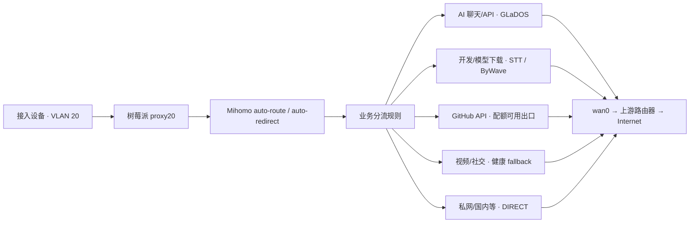

# Raspberry Pi 5 透明网关

基于 Debian 13 / ARM64、Mihomo、dnsmasq 和 MosDNS 的透明网关。接入网关的设备共用业务分流策略：**AI 聊天走 GLaDOS，模型和开发下载走 STT / ByWave**；设备无需分别安装代理客户端。

仓库维护运行脚本、systemd 单元、公开策略模板、固定版本核心补丁，以及恢复镜像工具。订阅、真实节点、凭据和设备流量记录保存在部署端。

> **核对日期：2026-11-08。** 本文对照当前代码与树莓派现场整理。服务周期、端口和策略以所链接的代码及私有配置为准；公开模板需要补齐部署参数，不能直接代替这台网关的完整配置。旧 WireGuard pilot 已退役。

[业务分流](#业务分流) · [网络与-dns](#网络与-dns) · [运维查询](#运维查询) · [服务与恢复](#服务与恢复) · [部署与版本一致性](#部署与版本一致性) · [开发与-ci](#开发与-ci) · [文档索引](docs/README.md)

## 业务分流

这是**当前部署策略**，作用于经过本网关的所有设备。规则按域名和业务匹配，没有为某一台 Mac、NAS 或其他设备单独指定机场。

| 业务 | 策略组 | 当前出口与选择方式 |
|---|---|---|
| AI 聊天、API 及相关认证依赖 | `GLaDOS AI Chat` | 仅 GLaDOS；按健康状态顺序 fallback |
| 模型、数据集及 AI 大文件 | `Model Download` | STT / ByWave；不进入 GLaDOS 下载池 |
| GitHub 页面、Git 传输与 Release 文件 | `GitHub Control` / `GitHub Download` | 按域名分别进入健康 fallback 或延迟选择组；STT / ByWave |
| `api.github.com` | `GitHub API` | STT / ByWave；独立配额检查器维护 select 组 |
| 包管理器、IDE、SDK、容器及构建工具 | `Package Download` / `Download` | STT / ByWave，保留 ByWave 下载候选 |
| YouTube 等视频与社交媒体 | `Streaming` / `Social` | 当前使用 STT / ByWave 的健康 fallback；吞吐量准入在现场关闭 |
| 私网、国内规则与其他流量 | `DIRECT` / 对应规则组 | 依规则顺序处理；未命中其他规则且没有域名的连接在当前部署中直连 |

分流由 [`mihomo-policy-overlay`](automation/sbin/mihomo-policy-overlay) 生成。开发下载默认域名在 [`route-defaults.yaml`](automation/policy/route-defaults.yaml)，当前公开策略段在 [`global-routing.example.yaml`](automation/policy/global-routing.example.yaml)。私有清单可按条目覆盖默认表；显式下载规则先于较宽的 AI 聊天域名规则。

公开 `capabilities.yaml` 是待配置模板：不会自动携带现场机场身份和节点池。恢复或迁移时需要合并策略段、配置账户识别和节点匹配，再生成并验证配置。详见[全设备分流、流量统计与 GitHub API 出口](docs/global-routing-and-traffic.zh-CN.md)。

### GitHub API 配额保护

[`mihomo-github-api-guard`](automation/sbin/mihomo-github-api-guard) 检查当前出口的匿名 API 配额。剩余配额不大于 5 时，最多验证 4 个候选，只切换到确认有额度的 STT / ByWave 节点；保留重置时间和 Retry-After 冷却信息。

检查在启动 30 秒后开始，每次完成后间隔 60 秒。它独立于下载组，只清理已知异常出口上连续一秒字节数未变化的 GitHub API 连接。正在进行的 API 请求仍可能需要重试；登录账号限额、专项限额和二级限流不能保证靠换出口解决。

### 流量可追溯

[`mihomo-traffic`](automation/sbin/mihomo-traffic) 按设备、机场、节点分别记录上传和下载量：

- 每 0.5 秒读取连接计数，按 5 分钟桶聚合，每 15 秒提交，保留 90 天。
- DHCP 设备身份绑定到连接；采集器重启通过检查点避免重复计数。
- SQLite 位于 `/var/lib/mihomo-traffic/traffic.sqlite3`，不保存访问 URL 或目标域名。
- 短于采样间隔的连接可能无法归属，报告保留全局总量与差额；采集开始前的流量无法补算，机场计费倍率也不在此统计内。

## 网络与 DNS

当前使用 `wan0` 连接上游，`proxy20` 是同一链路上的 VLAN 20 接口；VLAN 内设备经树莓派转发。现场 TUN 接管列表仍包含 `lan0` 和 `proxy20`，但旧下游 LAN 服务已退役，保留接口匹配不代表它在承载客户端。



数据面使用 `Mihomo` TUN、`inet mihomo` 自动重定向规则、策略路由表 `2022`，以及部署端 `rp_filter` / `rp_nat` 防火墙。**透明 TCP 重定向端口由核心运行时分配**，应读取实际 nftables 规则，不应把历史端口写成部署前提。显式 HTTP/SOCKS 代理当前使用 mixed-port `7890`。

DNS 有两条入口，并非所有设备依次经过同一条“三层链”：

| 查询来源 | 当前路径 |
|---|---|
| VLAN 20 客户端 | `dnsmasq-vlan-pilot` → `127.0.0.1:1053` Mihomo DNS（fake-IP） |
| 网关自身 | 环回 dnsmasq `127.0.0.1:53` → 正常模式下 MosDNS `127.0.0.1:5335` → 按域名选择国内解析或 Mihomo DNS |

DNS 故障时的上游切换由 [`mihomo-dns-mode`](automation/sbin/mihomo-dns-mode) 和相应服务处理。客户端 DNS/DHCP 与网关自身 resolver 分开配置；实际地址来自私有部署文件。

`wg-ucg-pilot` 已停止并屏蔽，当前核心不再依赖它。仓库的 [`ucg-link.conf`](automation/systemd/mihomo.service.d/ucg-link.conf) 是用于覆盖旧依赖的空占位。旧拓扑图及 WireGuard 文档保留作历史资料，首页使用上面的当前路径图。

## 运维查询

在已配置的树莓派上执行：

```sh
# 核心、DNS、统计与 API 检查服务
systemctl status mihomo mosdns dnsmasq dnsmasq-vlan-pilot \
  mihomo-traffic.service mihomo-github-api-guard.timer
sudo cat /run/mihomo-healthcheck/status
sudo cat /run/mihomo-healthcheck/paths

# 默认查询今天的流量，也可限定机场、时间或设备
sudo mihomo-traffic report
sudo mihomo-traffic report --since 2026-11-08 --airport GLaDOS
sudo mihomo-traffic report --device 192.0.2.10 --json  # 换成实际设备地址

# API 出口选择与检查记录；输出包含现场节点信息，仅在本地查看
journalctl -u mihomo-github-api-guard.service --since today
sudo cat /var/lib/mihomo-github-api/state.json

# 现场转发规则与策略路由
sudo nft list table inet mihomo
ip rule show
```

健康状态中的 `business=verified` 表示本地转发结构存在且计数增长，不能据此认定所有网站或设备正常。外网抽样看 `egress` 和 `paths`，客户端 DNS 看 `dns_1053`、`dns_udp`、`dns_tcp`；最后仍需从实际客户端验证目标网站。

## 服务与恢复

[`install.sh`](automation/install.sh) 在真实 systemd 主机上默认 enable **17 个单元：8 个 service + 9 个 timer**，不主动 start；另有 3 个维护 timer 保持 disabled。安装到 `GATEWAY_ROOT` 暂存目录时不管理宿主 systemd。

| 常驻或开机服务 | 职责 |
|---|---|
| `mihomo.service` | 预算包装器校验后启动核心；创建透明转发路径 |
| `mihomo-measurement-budget.service` | 本地探测预算 broker，准入 socket 为 `/run/mihomo-measurements/budget.sock` |
| `mihomo-traffic.service` | 持久化流量归属 |
| `mosdns.service` | 网关自身的分流解析 |
| `dnsmasq.service` | 环回 resolver，启动时准备直连解析基线 |
| `dnsmasq-vlan-pilot.service` | VLAN 客户端 DHCP / DNS |
| `homeassistant-access-guard.service` | 开机执行 Home Assistant 访问边界规则 |
| `rp5-agent.service` | 为监视器提供只读状态；`/health` 公开，状态端点要求 Bearer token |

| 定时器 | 仓库定义的调度与作用 |
|---|---|
| `mihomo-healthcheck.timer` | 每分钟观察本地转发、客户端 DNS 及按周期执行出口抽样 |
| `mihomo-dnsmasq-guard.timer` | 每 30 秒检查客户端解析入口与实际 DNS 上游，附带随机延迟 |
| `mihomo-github-api-guard.timer` | 启动 30 秒后首跑，完成后间隔 60 秒检查 API 配额 |
| `mihomo-subscription-update.timer` | 启动 1 分钟后首跑，每 10 分钟检查是否到期；成功后排 48 小时，失败按重试策略处理 |
| `mihomo-media-guard.timer` | 启动 2 分钟后、完成后间隔 1 分钟唤醒；当前私有策略关闭吞吐量准入 |
| `mihomo-watch.timer` | 启动 90 秒后、每 2 分钟巡检单元、硬件资源和上游链路 |
| `mosdns-healthcheck.timer` | 启动 30 秒后、每分钟检查 MosDNS |
| `mosdns-rules-update.timer` | 每日 04:20 更新规则，随机延迟最多 30 分钟 |
| `mosdns-binary-update.timer` | 每周日 05:10 更新程序，随机延迟最多 1 小时 |

`mihomo-download-quality.timer`、`mihomo-social-quality.timer`、`mihomo-rules-update.timer` 保持休眠。质量探测辅助代码仍会被 API 检查器复用；订阅管线负责相应规则生成，关闭这些 timer 不等于删除脚本。

### 故障怎样处理

| 观测结果 | 当前实现的动作 |
|---|---|
| 启动后缺少 TUN、实际 redirect 规则、过滤表或 `9000` 策略路由 | 启动门禁失败；启动门禁只核验本地转发结构 |
| 核心已停止 | timer 模式下尝试有界恢复；受维护锁、冷却及启动限额约束 |
| 核心运行但本地转发结构连续失败，或 `1053` 客户端 DNS 达到失败阈值 | 达到恢复条件后重启并复查；无效恢复保留冷却，确认恢复成功后清除尝试冷却 |
| 外网抽样失败或部分失败 | 标记 degraded 并按通知条件报告；仅外网异常不会触发核心重启 |
| 客户端 dnsmasq 静默，但上游有有效应答 | 分层 DNS guard 在次数与时间预算内恢复对应解析服务 |
| 需要通知用户的故障与恢复 | `mihomo-alert` 发送中文影响说明；按 key 去重，功能恢复与已发送故障配对，诊断事件可仅记日志 |

实现入口：[`mihomo-healthcheck`](automation/sbin/mihomo-healthcheck)、[`mihomo-dnsmasq-guard`](automation/sbin/mihomo-dnsmasq-guard)、[`mihomo-alert`](automation/sbin/mihomo-alert)。显式节点探测还受账户预算准入限制，间隔取决于私有策略，不能统一写成固定检测或恢复时限。

## 部署与版本一致性

仓库中的代码、公开模板和现场私有状态各有不同用途：

| 内容 | 维护位置与校验方式 |
|---|---|
| 运行机制 | `automation/sbin/` 的 32 个脚本、`automation/systemd/` 的 44 个文件，以及 journal / NetworkManager 配套文件；发布清单校验安装目标的内容和权限 |
| 策略与网络模板 | `automation/policy/`、`automation/etc/`、`automation/env/`；安装器保留已有私有配置，模板更新不代表现场自动跟随 |
| 核心 | [`core/upstream.json`](core/upstream.json) 固定上游提交，补丁与构建方式在 [`core/README.md`](core/README.md)；要求 `with_gvisor` 和 `mihomo-budget-v1` 协议 |
| 现场私有输入 | `/etc/mihomo/adaptive/capabilities.yaml`、订阅与凭据、网络身份、节点池及配置覆写；不上传公开仓库 |
| 动态状态 | 流量数据库、探测预算、API 配额状态、缓存和日志；只保存在部署端 |
| 恢复介质 | [`image/`](image/) 构建和校验恢复底包；已有 Release 镜像是发布时快照，不等同于最新 `main`，真实介质启动验收单独进行 |

2026-11-08 已完成现场同步：78 个受管理目标通过内容及权限核对，现场配置使用已安装生成器重新生成后完全一致。11 月 4 日的规则修复已经部署；此前“尚未部署”的例外说明已失效。这是一次验收记录，后续修改仍需重新校验。

### 安装或升级

先按[部署文档](docs/deployment.zh-CN.md)与[自动化说明](automation/README.zh-CN.md)准备系统依赖、核心、`wan0` / `proxy20` 网络和私有策略。文档中的旧 WireGuard 试点段落不属于当前部署步骤。

以下命令在仓库根目录执行；已有网关先查看工作区和远端变更，保持管理连接可用：

```sh
git status --short
git fetch origin
git diff HEAD..origin/main -- automation
# 确认本地分支与远端关系后快进到选定版本
git merge --ff-only origin/main

# 校验公开发布包及已有安装是否漂移，再安装
sudo automation/install.sh --dry-run
sudo automation/install.sh
```

安装器持有维护锁并保存回滚点；配置模板只在目标不存在时写入。它负责安装和 enable，不代替私有配置准备、核心构建、网络配置或显式服务启动。检测到漂移时应先核对并合并现场修改，不能删除锁或跳过校验覆盖。

当前版本的安装一致性可单独检查：

```sh
sudo python3 automation/check-release.py --root / --dry-run
```

业务配置变更另走 [`ops/mihomo-config-install`](ops/mihomo-config-install) 的候选校验、备份、原子替换与 API 复验流程；该工具需要另行部署，不由 `automation/install.sh` 安装。reload 失败时工具会尝试 restart，失败会回滚，因此应按实际变更评估连接影响。

## 开发与 CI

```sh
scripts/preflight.sh                    # 全量检查
scripts/preflight.sh --changed README.md # 按路径映射检查
scripts/preflight.sh --list             # 查看检查计划
```

依赖 Python 3.9+、PyYAML 与相应检查所需工具。检查映射的唯一来源是 [`verification-matrix.yaml`](tools/verification-matrix.yaml)；新增检查自动进入完整 gate，未知改动路径回落全量。SKIP 会使 gate 失败，不能当作通过。`--staged` 根据暂存改动映射检查，没有暂存改动时执行全量；`--profile core` 需要提供真实核心二进制。

[GitHub Actions](https://github.com/ashllll/rpi5-mihomo-gateway-guide/actions/workflows/validate.yml) 在 push 和 pull request 时执行三个作业：

| 作业 | 验证内容 |
|---|---|
| `preflight` | 完整检查、发布清单与公开内容/历史隐私扫描 |
| `core-build` | 构建固定版本核心，执行核心 profile，并交叉编译 ARM64 |
| `core-build-arm64` | 在 ARM64 runner 原生构建并执行版本、编译标签及预算协议断言 |

运行入口均为 [`scripts/preflight.sh`](scripts/preflight.sh)。Git hooks 是否安装属于本地环境，仓库不假设每个克隆都已有 pre-push hook。旧 `.gitea/` 工作流作为历史文件保留，当前发布验证使用 GitHub Actions。

## 继续阅读

| 主题 | 入口 |
|---|---|
| 业务分流、流量查询、API 出口限制 | [当前运行策略](docs/global-routing-and-traffic.zh-CN.md) |
| 安装文件、参数与单元定义 | [自动化说明](automation/README.zh-CN.md) |
| 部署与维护操作 | [部署](docs/deployment.zh-CN.md) · [运维](docs/operations.zh-CN.md) |
| 核心补丁与预算协议 | [核心构建](core/README.md) |
| 恢复镜像及验收边界 | [恢复镜像](docs/recovery-image.zh-CN.md) |
| 访问控制、发布隐私与验证 | [安全边界](SECURITY.md) · [验证矩阵](docs/wiki/validation.md) |
| 历史事故和设计决策 | [调试档案](docs/deployment-debugging-summary.zh-CN.md) · [ADR](docs/adr/README.md) |

[完整文档索引](docs/README.md) · [CC0 1.0 Universal](LICENSE)
