# 当前架构：本地双网口透明网关

更新日期：2026-10-11。本文不包含真实 IP、MAC、用户名、SSID、订阅和节点凭据。
这里的示例拓扑使用虚构的 10.66/10.77 网段，具体值由部署者提供。

```text
Internet → 上游路由器（DHCP / NAT）
                 ├── 主 Wi-Fi → 管理终端 → Pi 的 wan0 地址（SSH）
                 └── wan0 → Raspberry Pi 5 → lan0 → 桥接 AP / 交换机 → 客户端
                                ├── dnsmasq :53 / DHCP
                                ├── MosDNS 127.0.0.1:5335
                                ├── Mihomo DNS 127.0.0.1:1053
                                ├── Mihomo TUN + auto-redirect
                                └── nftables 转发 / NAT
```

Pi 不必连接管理 Wi-Fi；管理终端可连接上游 Wi-Fi，经上游 LAN 访问 Pi 的 wan0。
旧 iKuai 设备已经移除，此设计没有 iKuai 依赖。上游路由器与下游 AP 也不需要运行代理。
网络接口按永久 MAC 在部署端固定命名，仓库不发布实际 MAC 或 NetworkManager 连接文件。

## DNS 数据流

客户端 → dnsmasq → MosDNS。MosDNS 对国内域名优先用国内 DNS，代理域名交给
Mihomo DNS；未知域名使用国内 IP 校验和延迟回退。Mihomo 独占 fake-IP 映射。
MosDNS 只缓存国内真实答案，不长期缓存 fake-IP，不转发客户端 ECS。
当前下游为 IPv4-only；AAAA、SVCB、HTTPS 查询在此过渡配置中返回 NODATA，
这是部署取舍，不是所有网络通用的 DNS 推荐。

生成器默认采用更简单的 dnsmasq → Mihomo DNS 基线，不会冒充已集成 MosDNS 的完整方案。
MosDNS 的配置骨架与自定义域名规则已随 [`automation/`](../automation/README.zh-CN.md) 发布，
规则数据（国内 / 代理域名集合与 CN IP 集合）需自行准备，并通过候选实例验证后再切换 DNS 上游。

## 代理职责

| 类别 | 策略与约束 |
|---|---|
| 国内网站 | 国内规则 / IP 直连，避免视频和 CDN 绕远 |
| 游戏 | 域名/IP 规则直连；网关不能按客户端进程完整识别所有游戏 |
| AI | 专用供应商池（本部署使用 GLaDOS），优先稳定地区和出口 |
| 浏览 / Telegram / Streaming | 按业务使用自动组，允许跨供应商备份 |
| GitHub Control | 网页 / API / Git 控制路径独立选路 |
| Download / Model / GitHub Download | STT、ByWave 和明确授权下载的 GLaDOS 节点 |

供应商能力必须由部署者明确填写。普通 GLaDOS 节点不可被默认加入下载池，
专用下载节点也不能仅凭名称正则判定。STT / ByWave 在本部署被允许大流量下载，
不代表所有套餐或今后的服务条款均如此。仓库不附带任何供应商订阅链接或节点清单。
同一域名同时承载聊天、图片、视频和下载时，域名规则不能保证按内容体积精确分流。

## 自动化层

[](../assets/current-automation.svg)

生产环境有订阅更新、规则更新、分类健康检查、评分采集及受保护的节点隔离任务。这些单元与脚本已随
[`automation/`](../automation/README.zh-CN.md) 发布：八个 timer、评分采集（影子模式）、受门禁的隔离执行、
DNS 模式自愈与 MosDNS 回退，节点标签与订阅链接留在部署端。评分采集以影子模式观察；隔离执行仅在连续故障、
候选池保底和验证门禁满足时动作。机制细节见[智能选择](adaptive-selection.zh-CN.md)。

订阅更新间隔至少 24 小时，低峰运行并加随机延迟。systemd 的 Persistent=true
可能在首次启动或补漏时立即触发一次任务，不能只看 OnCalendar 判断是否会执行。
更新必须先解析、验证、保存回滚点，切换后检查真实业务，失败保留旧配置。

## 当前验证和限制

现场确认：两口协商 2.5Gbps，全双工；4 核 Cortex-A76；内存约 8GiB；NVMe。
低负载采样时约 99% CPU idle、温度约 34°C、可用内存约 6.7GiB，说明该时刻有余量，
不构成 2.5Gbps 加密转发的吞吐保证。单队列网卡共享中断，RPS 关闭，值得负载测试后评估。
暂未实施 BBR、超频、强制 performance governor 或未经验证的 backlog 调参。

健康检查通过不代表浏览器登录或长时间下载已验证。当前曾观察到 GitHub API
共享出口的未认证额度耗尽导致规则更新失败，已有 DNS 规则继续工作；不可绕过校验
或把失败清零冒充更新成功。HA 等服务可与网关共存，但数据库、容器卷和配置需独立备份。
