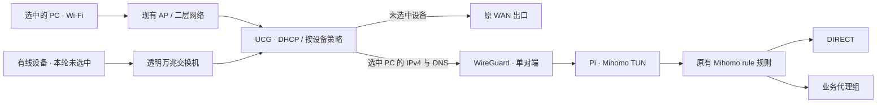

# UCG → WireGuard → Mihomo：单设备链路迭代

记录日期：2026-10-20。本文发布脱敏的配置差异、操作顺序、验收证据与待办。
真实地址、客户端标识、订阅、WireGuard 密钥、完整配置和截图留在部署端的私有归档。
这是已有网关的手动整合记录，尚未接入项目的一键安装器。

## 目标、范围与拓扑

设备存在 Wi-Fi 和有线两种接入方式。UCG 继续负责客户端网关、DHCP 与设备策略；
下挂的兮克 8300 万兆交换机按透明转发使用。本轮没有改交换机 VLAN，也没有将第三方交换机纳入 UniFi 管理。

本轮仅选择一台 PC 的 Wi-Fi 身份。PC 的网络接口、网关和 DNS 设置未修改，
PC 有线身份继续沿原路径，其他设备不加入试点。用户使用 UU 远程，
切换前确认连接正常；后续确认网页可以打开，最后一轮 DNS 完善后的远程交互体验仍待确认。



图中的 AP 与交换机仅表示接入角色，不断言现场每条网线的物理连接关系。
若未来使用 VLAN，沿途交换机/AP 仍需具有匹配的二层配置；UCG 的策略配置不会自动配置第三方交换机。

## 变更前后

| 层次 | 变更前 | 本轮完成的变更 |
|---|---|---|
| 客户端 | PC 已有固定租约；Wi-Fi / 有线具有不同身份 | 保留接口设置，仅以 Wi-Fi 身份作为试点范围 |
| UCG 入口 | 已有试验 VPN / 路由对象，但需核对启用状态与真实流量 | 保持单 PC 策略经 VPN；Kill Switch 启用 |
| Pi WireGuard | 本轮实机脚本要求目标接口不存在才创建 | 复用已有试验密钥，单对端，MTU 1380；写入私有持久配置 |
| Pi 防火墙 | 原有 LAN 透明代理与上游出口 | 为 WG 握手、透明重定向、转发及对端 NAT 增加限定规则 |
| Mihomo 接管 | `include-interface` 仅有原下游接口 | 增加 WG 接口，保留原 LAN；`mode: rule` 与 1266 条规则不变 |
| PC DNS | 缺少完整的单 PC DNS 接管证据 | UCG 对该 PC 的 TCP/UDP 53 做 DNAT 到隧道内 Pi 地址 |
| IPv6 | IPv4 策略不保证覆盖 IPv6 | UCG 仅对该 PC 的 MAC 拒绝 IPv6 外网及访问网关的 IPv6 DNS |
| 域名识别 | 仅靠现有 DNS / 连接元数据 | 增加单 WG 对端范围的嗅探，禁用目标地址覆盖 |
| Fake-IP | 原有 Fake-IP DNS | 保持 Fake-IP；启用映射持久化 |
| 地址稳定性 | PC 已保留地址；Pi 上游地址来自 DHCP | 核对 PC 保留，新建 Pi 当前上游地址保留 |
| 持久性 | 手动创建的 WG 与运行态 nft 规则 | 安装 WireGuard 工具，写入服务依赖与 nft include，接管现有接口 |
| 自动回退 | 先设置 20 分钟回退为隧道直连 | 按用户“暂不回退”指令停止；当前链路继续运行 |

本轮没有更改业务节点、订阅、原 LAN 的 dnsmasq / MosDNS 分层、交换机端口或 PC 网络接口。
后续订阅候选生成的干跑检查确认保留 `tun`、`dns`、`sniffer`、`mode`、`ipv6`；
这不是未来任意版本更新都保留这些字段的保证。

## 配置清单与数据路径

部署参数见 [人工参数清单](../examples/ucg-pilot.example.json)。尖括号为必填占位符；
清单不被现有安装器读取，也不能直接作为生产配置加载。

### UCG 原生配置

| 对象 | 配置要点 | 范围和证据 |
|---|---|---|
| WireGuard VPN Client | 指向 Pi 上游地址与配置端口；使用既有试验密钥 | 配置与握手均有现场证据 |
| 按设备策略 | PC 的 Wi-Fi 身份 → VPN；启用 Kill Switch | 不能仅凭策略名称认定流量命中 |
| DNS DNAT | 选中 PC IPv4、所属 LAN 网络、TCP/UDP 目的 53 → Pi 隧道地址的 53 | 隧道抓包观察到 DNS 查询、响应及 Fake-IP |
| IPv6 外网规则 | 选中 PC 的 MAC → 外网 IPv6，Reject | 已保存回读；强制 IPv6 访问未实测 |
| IPv6 网关 DNS 规则 | 同一 MAC → 网关 IPv6、TCP/UDP 53，Reject | 使用目的端口对象；不把所有 LAN IPv6 一并禁止 |
| DHCP 保留 | PC 原保留继续使用，Pi 保留其当前上游地址 | 不要求 PC 改为静态网络接口配置 |

记录没有保存 UCG 变更前的全机配置导出；前态按已有对象、会话记录及现场截图描述，
不能将其当成可直接恢复整个 UCG 的备份。策略匹配顺序和网络对象 ID 需在实际站点核对。
DNS 53 拦截没有证明所有 DoH/DoT 被识别或拦截。

### Pi WireGuard 与防火墙

WireGuard 私有配置存于 `/etc/wireguard/<WG_INTERFACE>.conf`，权限为 root-only。
使用站点参数填写 `Address`、`ListenPort`、`MTU`、`PrivateKey` 与对端 `PublicKey` / `AllowedIPs`；
`Table = off` 避免让 wg-quick 额外接管出口路由。不要在仓库记录真实密钥。

现场 UCG 对转入隧道的流量使用对端地址，因此 Pi 的对端源地址同时作为试点辨识依据；
扩展到多设备后，该地址无法再唯一识别每个原始客户端。

新增 nft 规则的语义如下，实际表名、接口与地址必须引用部署参数：

1. INPUT：仅允许来自 UCG 上游地址、发往 Pi 端点的指定 UDP 端口。
2. INPUT：允许从 WG 接口进入且 `ct status dnat` 的透明重定向数据。
3. FORWARD：WG → Mihomo TUN。
4. FORWARD：WG → 上联网口，供直连出口。
5. POSTROUTING：对端源 `/32` → 上联网口执行 masquerade。

以上增量依赖现场已有的 established/related 返回流量处理和链结构，不能作为完整防火墙替换。
运行态规则带试点标识；持久规则在 `/etc/nftables.d/`，由现有主配置 include。
本轮只做 `nft -c` 语法检查，没有重载整个 nftables 规则集。

### Mihomo 配置差异

以下为合并意图，不是完整配置：

```yaml
mode: rule
tun:
  include-interface:
    - <EXISTING_LAN_INTERFACE>
    - <WG_INTERFACE>
  # 保留已有 auto-route、auto-redirect、strict-route 等设置
  dns-hijack:
    - any:53
    - tcp://any:53
dns:
  ipv6: false
  enhanced-mode: fake-ip
  # 保留现有监听地址、解析器、过滤项与 fake-ip-range
profile:
  store-fake-ip: true
sniffer:
  enable: true
  force-dns-mapping: true
  parse-pure-ip: true
  override-destination: false
  sniff:
    HTTP:
      ports: [80, 8080-8880]
    TLS:
      ports: [443, 8443]
    QUIC:
      ports: [443, 8443]
  # skip-src-address 必须覆盖除试点对端外的全部 IPv4，以及 ::/0。
  # 未填该范围前不要把这段作为配置应用。
```

单对端嗅探范围由对端 `/32` 的补集计算，避免写入固定站点地址。标准库可生成 IPv4 补集：

```python
from ipaddress import ip_network

def excluded_sources(peer_cidr):
    peer = ip_network(peer_cidr)
    if peer.version != 4 or peer.prefixlen != 32:
        raise ValueError("Expected one IPv4 peer /32")
    return [str(net) for net in ip_network("0.0.0.0/0").address_exclude(peer)] + ["::/0"]
```

合并时保留既有 `skip-domain` 等设置；真实核心配置校验通过后才 reload。
现场版本为 Mihomo 1.19.28。DNS 仍由 TUN 劫持导向既有 Mihomo DNS，
并未向整个上游 LAN 开放新的通用 DNS 服务。

### 启动顺序

`wg-quick@<WG_INTERFACE>` 在 nftables 后、Mihomo 前启动；Mihomo 增加对该实例的
`Wants` / `After`。为了接管已存在的接口，试点 drop-in 将启动命令改为：

```ini
[Service]
ExecStart=
ExecStart=/bin/sh -ec 'if ! /usr/bin/ip link show dev %i >/dev/null 2>&1; then exec /usr/bin/wg-quick up %i; fi'
```

这段仅在已核实接口地址、密钥对应关系、MTU 与对端正确时用于接管。它只检查接口存在，
不会自动校正已有接口的错误配置。路径需匹配发行版安装位置。
本轮服务 active/enabled、单元校验与顺序检查通过，没有执行真实重启验收。

## 操作顺序与已有证据

1. 核对 PC 远程连接与接入身份；先完成隔离模拟，生产配置摘要保持不变。
2. 保存 Mihomo 前态、路由、策略和 nft 规则；复用已有测试密钥创建 WG 单对端。
3. 增加限定防火墙规则，先保证隧道直连；设置临时回退，再将 WG 加入 Mihomo 接管。
4. 用真实 PC 连接记录验证 DIRECT / 代理、TCP / UDP 双向流量；用户确认网页可打开。
5. 按用户要求停止自动回退，保持代理；完善 UCG 的 PC 专用 DNS、IPv6 边界和地址保留。
6. 加入限定嗅探、Fake-IP 持久化；候选配置验证后 reload。现有业务规则未重新编写。
7. 安装持久单元与 nft include，通过语法及服务单元检查后接管已存在接口。
8. 检查订阅候选生成是否保留关键字段；对当前 PC 连接及站点连接采样，保存私有证据。

“完全按照 Mihomo 分流”应限定为：**进入这条隧道并被 TUN 接管的流量，继续由原有
Mihomo rule 规则与策略组决定出口。** UCG 先决定哪些设备进入链路；IPv6 范围、
DNS 缓存、加密 DNS、纯 IP 请求和无法获取域名的连接都会影响可用的匹配信息。
启用嗅探不等于识别所有连接，也不能把网关规则当成 PC 的进程分流。

## 验证矩阵

| 层次 | 已记录结果 | 仍不能推断 |
|---|---|---|
| 独立 Linux 命名空间 | 23 项预期行为/故障重现检查通过 | UniFi 固件的所有真实实现行为 |
| TCP / UDP 与其他客户端 | 选中设备可直连/代理，未选中设备保持原出口 | 现场全部设备都经过完整验收 |
| DNS 模拟 | UDP/TCP Fake-IP 可用；全局 DNS 会破坏未选中客户端；限定范围后恢复 | 所有加密 DNS 都被接管 |
| IPv6 模拟 | 复现 IPv4 策略下 IPv6 绕行；限定封锁不影响其他模拟客户端 | PC 强制 IPv6 实测通过 |
| 远程回程模拟 | 简单源策略可破坏入站回程；连接标记例外恢复 | UCG 实机存在相同缺陷，或已在 UCG 部署该模拟修复 |
| 隧道故障模拟 | 选中设备外网受阻，未选中出口及同 LAN 远程仍可用 | 已在实机主动断隧道验收 UU |
| PC 实机采样 | 13:08:58，127 条连接；57 DIRECT、70 非 DIRECT，124 条双向 | 其余 3 条必然故障，或全部业务长期稳定 |
| DNS 实机采样 | 15 秒观察到 5 查询、5 响应及 1 条 Fake-IP 响应 | 长期无 DNS 绕行 |
| 站点采样 | Google 29 条、YouTube 2 条走代理；Bilibili 3 条直连；均有双向数据 | 视频画质、持续播放或账号体验已验收 |
| 持久化 | 配置、服务状态、nft 与 systemd 校验通过 | 已经完成重启恢复 |

连接统计是同一天不同时间的快照，不能相加作为成功率分母。1266 是该次现场配置的规则数量，
不是仓库安装器固定生成的规则数。用户最后一轮 UU 交互/视频体验、强制 IPv6 检查、
有线 PC 身份、长期负载及重启恢复仍待验收。

## 保持现状与未来回退

本轮按用户要求保持新链路，未执行回退。早期 `pilot.py fallback` 仅移除 WG 的代理接管，
适用于当时“隧道保留、直接转发”的阶段。**加入 Fake-IP DNS 接管后，该操作单独执行已不足以恢复。**

未来回退需准备备用管理通道并协调以下顺序，而非直接拆 WG：

1. 保持隧道、PBR 和现有转发可用；先撤销该 PC 的 DNS DNAT，恢复原有真实 DNS 答复。
2. 使客户端及应用中旧 Fake-IP 缓存失效，确认重新解析获得真实地址；保留可用的管理连接。
3. 将该 PC 的 UCG 策略移回原出口，核对 UU 与普通访问；Kill Switch 与路由同步调整。
4. 再移除 WG 的 Mihomo 接管、专用防火墙及服务依赖；最后撤销不再需要的 IPv6 限制。
5. 按前态和新增对象清单清理持久文件；检查未选中设备与原 Pi LAN。

这些步骤尚未在最终 DNS 配置下实演，不是经过验收的一键回退脚本。
新设备推广前先完成强制 IPv6、远程软件、故障断链与重启测试；按设备或受管 VLAN 逐步扩围。

## 私有归档与后续迭代

部署端归档包含前态、持久配置快照、操作脚本、模拟结果、现场采样、UCG 截图和校验清单；
目录及归档采用私有权限。仓库仅保存本文与占位参数，不接收原始归档。
UCG 全机前态导出、真实重启和最终用户体验缺失的证据明确保留为空。

后续可在验证单设备运行语义后，设计独立的可参数化 UCG 接入生成器及协调回退工具。
本次提交只沉淀已发生的变更，不将试点脚本自动接入现有安装器或宣称有线、VLAN 全网推广已经完成。
